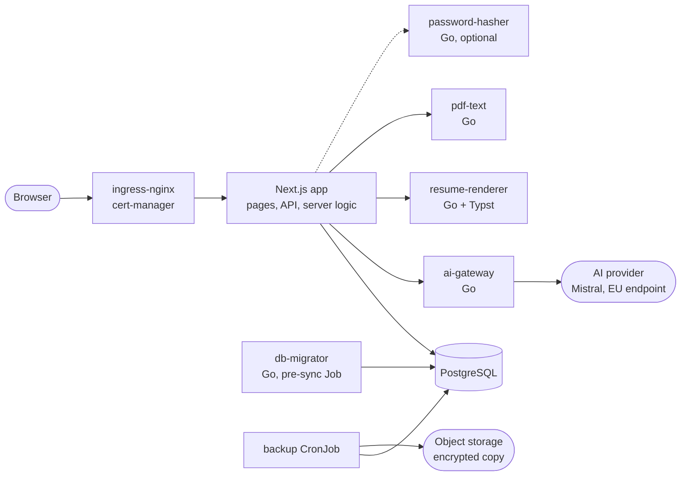

# FastResume

**One job. One resume. Three clicks.**

A free web app that tailors a resume to each job offer. You fill a library of experiences, projects, skills and education once; for each offer, the app ranks what fits best and produces the PDF. It runs in production at [fastresume.tech](https://fastresume.tech), hosted in France on OVHcloud. The repository holds the whole system: the app, the services, the infrastructure, the delivery pipeline, the monitoring, the load tests and the post-mortems.

What the product promises and will never do: [`docs/charter.md`](docs/charter.md).

## What it does

1. **Add** a job offer.
2. **Rank**: an AI reads the offer and the library and recommends the experiences, projects and skills to show. The code, not the model, makes the final choice and checks every answer.
3. **Download** the PDF. Two templates with colour and size options, and a fit-to-page mode that picks the text size so the content fills exactly one page.

Also: import of an existing resume from a PDF (personal details are taken out by code before any AI sees the text), several versions of a description chosen per job, a title and a profile suggested for each offer, export of all your data, and deletion of the account.

## Where the effort went

| Topic | What was done | Details |
|---|---|---|
| **AI cost, speed and quality** | A Go gateway owns the provider, the key, the timeouts and the output checks. The model's answer is treated as untrusted input (short labels, each one validated). Cost went from about 3 to 10 EUR per 1,000 rankings to **0.60 EUR**, and the time from 20 to 99 s to **about 3 s**, measured with an evaluation tool on 45 real offers. | [`docs/reports/2026-10-09-ai-ranking-case-study.md`](docs/reports/2026-10-09-ai-ranking-case-study.md), [`eval/`](eval/README.md) |
| **PDF rendering** | A separate Go service compiles [Typst](https://typst.app) templates from one JSON file. Its pod has a read-only filesystem, no capabilities, no outgoing traffic, and accepts connections from the app only. | [`services/resume-renderer/`](services/resume-renderer), [`k8s/resume-renderer/`](k8s/resume-renderer) |
| **Delivery** | GitHub Actions detects what changed and builds and tests only that. A merge builds the images and commits their new tags to the manifests; Argo CD shows the diff and a person syncs. Migrations run as a pre-sync Job. | [`.github/workflows/`](.github/workflows), [`CONTRIBUTING.md`](CONTRIBUTING.md) |
| **Capacity and reliability** | k6 load tests that look for the breaking point of each scenario, with the history of every run. A memory incident on the node is written up as a post-mortem, followed by a measured report on the memory margin and alerts by email (Alertmanager) on memory pressure, evictions and the app being down. | [`docs/reports/load-tests.md`](docs/reports/load-tests.md), [`docs/incidents/`](docs/incidents), [`docs/reports/2026-10-13-node-memory.md`](docs/reports/2026-10-13-node-memory.md), [`docs/monitoring.md`](docs/monitoring.md) |
| **Backups** | A nightly dump kept 7 days, and a copy encrypted with `age` before it leaves the pod, in an object storage bucket on another site than the cluster. A Job restores the latest backup into a scratch database, counts the rows and times it; the procedure is a runbook. | [`docs/runbooks/restore-postgres.md`](docs/runbooks/restore-postgres.md), [`k8s/postgres/`](k8s/postgres) |
| **Abuse and runaway cost** | Size limits on every input, rate limits, a queue in front of password hashing, per-user AI quotas (hour, day, week), a monthly cap in euros and a kill switch. | [`src/lib/README.md`](src/lib/README.md), [`src/lib/ai/`](src/lib/ai/README.md) |
| **Security and privacy** | Content Security Policy with a nonce, a check of the origin of API requests, sessions kept in the database, no tracking, and a privacy page that states only what the code does. | [`docs/security.md`](docs/security.md), [`src/proxy.ts`](src/proxy.ts), [`docs/charter.md`](docs/charter.md) |
| **Frontend** | Design tokens and a short list of component roles; a test fails when a screen bypasses them. | [`docs/design/`](docs/design) |

## Architecture



The Go services are small, each with its own image, and talk to the others over HTTP. The app never calls the AI provider directly.

## Stack

| Layer | Technology |
|---|---|
| App | Next.js 16 (App Router), React 19, TypeScript, Tailwind CSS 4, Base UI, Zod |
| Services | Go (standard library HTTP, `log/slog`), Typst |
| Data | PostgreSQL 17, plain SQL migrations embedded in a Go binary |
| Infrastructure | OVHcloud managed Kubernetes, Kustomize, Argo CD, ingress-nginx, cert-manager |
| Provisioning | Terraform (OVH), Ansible |
| CI and delivery | GitHub Actions, GHCR images, Dependabot |
| Observability | Prometheus, Grafana, Alertmanager (email), an external uptime probe |
| Tests | Vitest (131 test files, SQL tests run against the real migrations), Go tests, k6 |

## Repository map

| Path | Content |
|---|---|
| [`src/`](src/README.md) | The Next.js app: pages and API routes, components, server logic, schemas, types, tests |
| [`services/`](services) | The five Go services: `ai-gateway`, `resume-renderer`, `pdf-text`, `password-hasher`, `db-migrator` |
| [`k8s/`](k8s) | Kubernetes manifests (Kustomize), monitoring values, the Argo CD application |
| [`terraform/`](terraform), [`ansible/`](ansible) | The cluster and the DNS; the secrets it needs |
| [`.github/`](.github) | CI and CD workflows, issue forms, Dependabot |
| [`eval/`](eval/README.md), [`scripts/`](scripts) | The AI evaluation tool and its cases; maintenance scripts |
| [`load/`](load/README.md) | k6 load tests |
| [`docs/`](docs) | Charter, design guidelines, post-mortems, measured reports, brand |

## Run it locally

Needs Docker, and Node 22 (`.nvmrc`) to run the app itself. One command starts the database, applies the migrations, starts the services of production (PDF renderer, PDF reader, password hasher, and the AI gateway when there is a key) and runs the app:

```bash
npm run stack                  # http://localhost:3000
```

The first time it builds the images (a few minutes) and makes `.env.local` from `.env.example`. Everything has a default for a laptop and listens on `127.0.0.1` only.

| Command | What it does |
|---|---|
| `npm run stack -- --docker` | The app too in a container (the production image): nothing but Docker is needed |
| `npm run stack -- --services` | Only the database and the services, to run the app yourself |
| `npm run stack:seed` | A demo account with a small library and a job: `demo@example.test` / `demo-password-1` (fictional) |
| `scripts/stack.sh restore FILE` | Loads a backup (`.sql.gz`, or `.sql.gz.age` with the private key) into the local database |
| `scripts/stack.sh status` | What answers, and where |
| `npm run stack:down` | Stops the services; the data stays. `scripts/stack.sh reset` also deletes the database |

The AI ranking and the resume import need a key: put `AI_TOKEN` (and `AI_BASE_URL`, `AI_MODEL` if you do not use Mistral) in `.env.local` and the gateway starts with the rest. Without it the app works and those two features say the AI is unavailable. Mails are printed in the console in development.

A backup of production holds the data of real people: restore one only to look into a problem, keep it on your machine, and delete it after. To read the latest one, with the keys of `docs/runbooks/restore-postgres.md`:

```bash
rclone copyto :s3:fastresume-db-backups/<the latest file> ./backup.sql.gz.age
scripts/stack.sh restore ./backup.sql.gz.age && rm ./backup.sql.gz.age
```

## Tests and checks

```bash
npm test               # unit tests; the ones that need PostgreSQL are skipped without it
npm run test:db        # the SQL tests, with TEST_DATABASE_URL pointing at a throwaway database
npm run lint
npx tsc --noEmit
(cd services/<name> && go test ./...)
```

How the database tests protect real data, and the whole path from ticket to production, are in [`CONTRIBUTING.md`](CONTRIBUTING.md).

## How the work is organised

Every change starts as a GitHub issue with a goal and a "done when" list, goes through one branch and one pull request, and is checked by CI before a squash merge. Measured results are written down in [`docs/reports/`](docs/reports) with the commands that produced them. A production incident gets a post-mortem in [`docs/incidents/`](docs/incidents) and one ticket per action.

## Status

The product is live. The code is under the [AGPL-3.0](LICENSE): anyone may read, run and improve it, and a hosted copy must stay open too. Security: [`SECURITY.md`](SECURITY.md) and [`docs/security.md`](docs/security.md).

Author: Quentin Rebergue.
