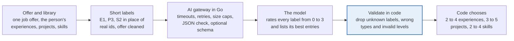

# Making an AI resume ranker cheap, fast and measurable

**Date:** 2026-10-09
**Work:** tickets #44 (AI gateway), #184 (ranking quality), #188 (spending limits), #192 (change of provider); PRs #180 to #195 and the ones that followed.

## Summary

FastResume's AI ranking now costs about **0.60 EUR per 1,000 rankings** and answers in about **3 seconds**. The first working versions cost 3 to 10 EUR per 1,000 and took 20 to 99 seconds, with weaker and less reliable results.

The feature reads a job offer and a person's library of experiences, projects and skills, and recommends which entries to put on the resume. This document tells how it got from a first prototype to this point: an AI gateway written in Go, a custom evaluation tool, about twenty ideas tested against real job offers, and the discipline of not trusting a result before checking it was not chance.

| | First setup (OVH, Llama 3.3 70B) | First Mistral Medium setup | Now (Mistral Small) |
| --- | --- | --- | --- |
| Cost per 1,000 rankings | about 3.1 EUR | about 9.5 EUR | **0.60 EUR** |
| Time per ranking, median / worst | 58 s / 99 s, 21 s / 93 s after the prompt rework | 6.0 s / 7.5 s | **3.0 s / 6.8 s** |
| Entries the author expected that were picked (recall) | 51 % on 5 offers, 73 % after rework | 88 % on 5 offers | 68 % on 45 offers |
| Share of picks the author expected (precision) | 62 %, 63 % after rework | 76 % | 78 % |
| Invented ids / forgotten entries per ranking | 0.33 / 5.4 | 0 / 0 | **0 / 0** |

The columns use different test sets: compare within a column, not across. The 5-offer set was too small to trust, which is the story of the section on chance below. On the 45-offer set, Mistral Small and the ten times more expensive Mistral Medium are statistically indistinguishable.

What mattered most:

1. **A gateway** that owns the provider, the key, the timeouts and the output checks, so the app never talks to a model directly and a provider change is a configuration change.
2. **Treating the model's answer as untrusted input**: short labels instead of ids, every label validated in code. Invented ids went from 0.33 to 0 per ranking.
3. **Asking the model to rate, and letting the code choose**: rating every entry removed forgotten entries (5.4 to 0) and raised recall from 51 % to 73 % on the first set.
4. **Cutting tokens where they cost money**: output tokens dropped from 1,049 to about 450, mostly by deleting what nothing read and asking for minified JSON.
5. **Measuring honestly**: widening the test set from 5 to 45 real offers showed that a promising YAML format gave nothing, and that the small model matches the large one.

## Context and constraints

FastResume lets a student or graduate keep a library of experiences, projects, skills and education once, then build a tailored resume for each job offer. The AI ranking is the step that reads the offer and the library and recommends which entries to show. The person stays in control: recommendations pre-select checkboxes, nothing is forced.

Four constraints shaped every decision:

- **Cost.** The product is free and aimed first at a school. One thousand rankings is ten resumes for a hundred students, which can happen quickly. At about 10 EUR per 1,000 rankings the first version was too expensive for that.
- **Speed.** A person waits on the button. The first measurements showed 20 to 99 seconds, which is too long and sometimes beyond a 60-second proxy limit.
- **Reliability.** A model that invents an id, forgets an entry or breaks its output format cannot be allowed to reach the interface.
- **Privacy and hosting.** The product promises European hosting and minimal data sharing, so the choice of provider and what goes into a prompt (no name, no contact details) are product decisions, not only technical ones.

The infrastructure is deliberately small: one Kubernetes node (2 vCPU, 4 GB of memory) on OVHcloud, deployed with Argo CD and GitHub Actions, for about 30 EUR a month in total. Any new service had to fit in tens of megabytes.

## Architecture: an AI gateway in Go

Every AI call goes through one small Go service, the gateway, built with the standard library only. It exists because a browser must never hold an API key, and because limits, retries and accounting belong in one place rather than in every feature.

The model never decides alone: its answer goes through a validation step in code, and only then do rules choose what reaches the resume. The gateway hides the provider: OVHcloud first, Mistral now.

What the gateway does:

- **Speaks one protocol.** It calls any OpenAI-compatible chat endpoint, so moving from OVHcloud AI Endpoints to Mistral changed three environment variables (address, key, model name), not code.
- **Bounds every call.** A timeout per attempt and one for the whole request, retries with growing delays on network errors, 429 and 5xx (not on a 400), a cap on prompt size and on output tokens.
- **Checks the answer.** It refuses a reply that is not valid JSON, and can pass a JSON Schema to the provider so the model cannot write a value the schema forbids. A free-text mode exists for experiments.
- **Is cheap to run and safe to expose.** About 24 MB of memory requested, non-root, read-only filesystem, health and readiness probes, graceful shutdown, a network policy that lets only the application call it and lets it call out only on HTTPS.

What the application does around it:

1. **Labels, not ids.** Each library entry gets a short label (E1 for an experience, P3 for a project, S2 for a skill). The model never sees or writes a real id.
2. **Rate every entry.** The model gives each label a level from 0 to 3 and lists its best entries.
3. **Validate in code.** Unknown labels, labels of the wrong type and invalid levels are dropped and counted. The answer is treated as untrusted input.
4. **The code chooses.** Which entries reach the resume (2 to 4 experiences, 3 to 5 projects, 2 to 4 skill sections) is decided by rules in code, not by the model.

The gateway and the answer format were written step by step, each step merged on its own with tests: a skeleton with retries and strict JSON, then deployment (manifests, network policy, CI and CD), then the ranking switched onto it with the Claude and Gemini code removed, then the optional schema and text format.

## How we measure: a custom evaluation tool

Optimising without measuring is guessing, so the first thing built after the gateway was a small evaluation tool (`npm run eval:ranking`, see [`eval/README.md`](../../eval/README.md)). It runs real job offers through the real pipeline, gateway included, and compares the result to what the author would have chosen.

Each **case** is a real job offer plus the author's library plus an `expected` selection: the entries the author would put on that resume. Cases are kept out of the repository because they contain personal data.

| Figure | What it tells |
| --- | --- |
| Recall | Of the entries expected, how many the AI recommended |
| Precision | Of the entries recommended, how many were expected |
| Forgotten entries | Entries the AI never rated at all, as opposed to judged low |
| Invented ids | Labels the model made up or put in the wrong list, counted before the code drops them |
| Stability | How much the selection changes between runs of the same offer |
| Time and tokens | Median and worst time, tokens in and out, as reported by the provider, not estimated |
| Cost | Euros per ranking, split between the prompt and the answer, then by part of each, to show where to optimise |

The tool grew with the questions we asked it:

- **Named references.** One saved reference per way of ranking, refused if the run had failures (the first reference was saved from a run of 45 failures; the tool now prevents that).
- **Cost by part.** A table of where the money goes: prompt parts (offer, projects, experiences, skills, instructions) and answer parts, so each optimisation is aimed at a real share of the bill.
- **Case-by-case comparison with a confidence interval.** Added after we suspected a result was chance (next section). It says on how many offers a figure improved, worsened or stayed the same, the mean change, its 95 % interval, and whether it is probably real.
- **Inspection.** Options to print the exact request, the raw answer, the answer as the app reads it, and a dry run that sends nothing.
- **Comparing two saved references** without calling the AI again, and a `--help` that documents every option.

## What we tried, and what it gave

Every idea below was tested with the evaluation tool. Figures come from those measurements; the test set grew over time (5, then 15, then 45 offers), so each row says which set it was measured on.

| Idea | Result | Verdict |
| --- | --- | --- |
| Send every AI call through a Go gateway with timeouts, retries and strict JSON | First real call worked in 29 s; failures became bounded and explicit; changing provider became a configuration change | Positive |
| Short labels (E1, P3, S2) instead of ids, every label validated in code | Invented ids 0.33 to 0 per ranking. One model had dropped a character of an 8-character id | Positive |
| Ask the model to rate every entry (levels 0 to 3), let the code choose within limits | Forgotten entries 5.4 to 0; recall 51 % to 73 % on 5 offers | Positive |
| Delete six answer fields no screen read, and a hidden AI-context input | Fewer output tokens, and it removed a hard-coded personal profile text that had been sent to the model for every user | Positive |
| Ask for minified JSON on one line (the model was indenting its answer) | Output 657 to 422 tokens on one offer (minus 36 %), same quality | Positive |
| Compact answer: all levels in one map, tags picked by number, new tags only | Output 954 to 457 tokens on Medium; cost per ranking minus 31 % | Positive |
| Move from OVHcloud (Llama 3.3 70B) to Mistral | Median time 21 s (worst 93 s) to 3 to 6 s, no more timeouts | Positive, hosting review still to do |
| Test the small model against the large one on a wider set | Mistral Small matches Mistral Medium (recall 68 % against 66 % on 45 offers) at one eleventh of the cost | Positive |
| JSON Schema on the answer (labels and levels as allowed values) | The provider enforces it: ordered to answer "E9, level 7", the model returned a valid label. Quality unchanged | Neutral, kept in a simple form |
| Clean the offer with rules (drop benefits, about-us, equal-opportunity text) | Minus 2 % cost, same quality: little to remove in real offers | Neutral |
| Put the unchanging parts of the prompt first, to help provider caching | Quality unchanged; the saving cannot be seen from our side | Neutral |
| Shorter keys, alternative formats such as TOON and LEAN | Researched, not built: structure is a small share of the tokens, most of them are free text | Neutral, skipped |
| A reasoning model (gpt-oss-120b) | No answer after two minutes: far too slow for a button | Negative |
| First JSON Schema with exact item counts and text lengths | 8 of 15 calls failed on OVHcloud: the server took too long to build its grammar. Simplified | Negative |
| Write the answer in YAML | Looked like plus 8 points of recall on 15 offers, nothing on 45 (see the next section) | False positive |
| Write the library in YAML in the prompt | Plus 10 % input tokens, lower recall | Negative |
| Fictional offers written to extend the test set | Written by us with tidy sections, so they flattered the offer-cleaning step and could not be trusted as a measure; replaced by real offers | Negative |

## Is it chance? Widening the test set

A YAML answer format looked like a clear win on 15 offers: recall up 8 points, better on 11 offers out of 15, a 95 % interval from plus 2 to plus 13 points. On 45 real offers the same comparison gave zero. The gap between those two results is the most useful thing the project taught.

| Comparison | Offers | Mean change in recall | 95 % interval | Reading |
| --- | --- | --- | --- | --- |
| YAML against JSON, Medium | 15 | plus 8 points | plus 2 to plus 13 | looked real |
| YAML against JSON, Medium | 45 | 0 points | minus 6 to plus 6 | nothing |
| Small against Medium, JSON | 15 | minus 2 points | minus 11 to plus 6 | no difference |
| Small against Medium, JSON | 45 | plus 1 point | minus 3 to plus 5 | no difference |

We had doubted the first result for three reasons, and acted on each:

1. **Few offers, coarse figures.** With about ten expected entries per offer, one entry more or less moves an offer by 10 points. A few points of average on five offers is easily chance. The test set grew from 5 offers to 15, then to **45 real offers**.
2. **Repeating a run adds little.** With the same prompt the model answers almost the same way each time, so three runs are not three independent samples. The tool now compares **case by case**, with a confidence interval, and we use one run per offer: more offers narrow the interval, more runs barely do.
3. **Variety.** Ten of the 15 offers had been written by us. They were replaced by real ones: 16 offers saved on the production site in a single day plus 29 saved earlier, covering low-level and operating systems, embedded, infrastructure, cybersecurity, networking, full-stack, quantitative finance, AI and one consulting offer, in French and English, from 1,000 to 8,000 characters. Three offers with no real job description (spontaneous applications) were set aside because they have no right answer.

One limit remains and is stated plainly: some offers are a poor fit for the author's library (a consulting role, a full-stack role in a different stack). On those, the expected selection is the least bad available and recall is low for every variant. That is label noise, not a model defect, and the next step is to audit those cases one by one.

## Where it stands and what is next

The setup the project is moving to is **Mistral Small with a JSON answer**: 0.60 EUR per 1,000 rankings, about 3 seconds, no failures on 45 offers. The gateway, the answer format and the evaluation tool are built and merged (the last tooling change is being merged); the application's provider switch is the remaining step, gated by a hosting and data review (location of processing, retention, legal wording) rather than by code.

Next, in order:

1. **Audit the low-recall offers.** For each, decide whether the model is wrong or the expected selection was debatable, and fix the cases before tuning anything else.
2. **Quotas and a spending cap in the gateway**: a daily limit per user, a monthly limit in euros, a kill switch, metrics and an alert, so a bug can never cost more than a known amount.
3. **Cheap quality ideas, now affordable at 0.0006 EUR per ranking**: combine two answers from the small model, test variants of the instructions, give the model keyword hints computed in code, and shortlist entries with embeddings if it is still needed.
4. **Keep a hold-out set** of offers never looked at while tuning, used only to confirm a change at the end.
5. **Test other libraries.** Everything so far is judged against one profile; two or three profiles from other students would show whether the tool only works for one person.

## Lessons and honest limits

Lessons that carry beyond this project:

- **Measure before optimising, and measure the right thing.** The cost table showed that output tokens, not the prompt, dominated the bill for the large model, which pointed to the first real savings.
- **Treat a model's output as untrusted input.** Short labels, validation and rules in code removed a whole class of failures that no prompt wording had fixed.
- **Separate judging from deciding.** The model rates; the code applies limits. Counts and thresholds are things models do poorly.
- **Cut what nobody reads.** Six answer fields no screen used were being generated, and paid for, on every call.
- **Doubt a good result.** The format that looked best on 15 offers was nothing on 45. Statistics matter most when the sample is small and the result is flattering.
- **A bigger model is not an answer by itself.** The model ten times cheaper matched the larger one once the pipeline around it was right.
- **Keep the evaluation data private and the tooling public.** Cases hold personal data and stay out of the repository; the tool, its tests and its documentation do not.

Limits, stated plainly:

- **One profile.** Every result is judged against a single person's library, oriented to systems and low-level work. Other profiles may behave differently.
- **Subjective expected answers.** The expected selections are choices, not facts. Many were proposed with an AI assistant and are subject to the author's validation; offers that fit the library poorly add noise to every variant.
- **Costs are upper bounds.** They apply the full price and ignore any caching discount the provider may give.
- **Not yet in production on the new provider.** The provider switch waits for the hosting and data review.

How it was built: the author led the design, the measurements and the decisions, working with an AI coding assistant (Claude Code) as a pair-programmer for code, tests and analysis. Each change was a separate ticket and pull request with its own tests.
